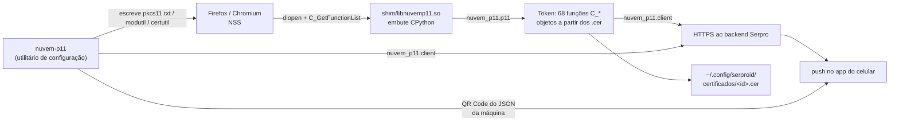

# nuvem-p11

Cliente livre do **SerproID**, o token de assinatura em nuvem da Serpro: a lógica PKCS#11, o
protocolo do backend e o utilitário de configuração reimplementados em Python.

> **Sem nenhuma ligação com a Serpro.** "SerproID" é marca do Serviço Federal de
> Processamento de Dados (SERPRO), e o nome aparece aqui apenas para dizer com o que este
> cliente é compatível. Este é um projeto independente, sem endosso, vínculo ou suporte da
> Serpro. Use por sua conta e risco: é software que fala com um serviço de credenciais.

O projeto tem duas peças:

* o **módulo PKCS#11** — o oficial é um `libserproidp11.so` que o navegador carrega no NSS;
  aqui a lógica PKCS#11 e o protocolo de assinatura são Python, com um shim nativo mínimo
  para o NSS poder carregar;
* o **utilitário de configuração** (`nuvem-p11`) — substitui o SerproID Desktop em JavaFX:
  registra a máquina no backend, mostra o QR Code para o aplicativo do celular, instala os
  certificados nos navegadores, testa e desinstala.

Foi verificado **byte a byte** contra o módulo oficial: `tools/dump_module.py` produz um dump
canônico de 156 linhas dos dois módulos e eles são idênticos. O teste final de aceitação foi
num Firefox de verdade, em `ccd.serpro.gov.br/testeaqui/`, com autenticação de cliente TLS
completa (o site respondeu *"Tudo Certo!"* validando o certificado).

Nada depende de pacote externo: o protocolo, o leitor DER, o gerador de QR Code e o parser de
PKCS#7 são biblioteca padrão do Python.

## Arquitetura



* `nuvem_p11/cli.py` — o utilitário de configuração: `status`, `associar`, `instalar`,
  `sincronizar`, `desinstalar`, `testar`, `relato`.
* `nuvem_p11/qr.py` — gerador de QR Code em Python puro (Reed-Solomon, máscaras, formato e
  versão), com render em meio-bloco Unicode para o terminal e PNG.
* `nuvem_p11/browser.py` — configuração do NSS: `pkcs11.txt` do Firefox, `modutil` do Chromium,
  `certutil` para as autoridades.
* `nuvem_p11/setup.py` — decodifica o que o backend devolve (inclusive a cadeia PKCS#7) e grava
  os certificados onde o módulo os lê.
* `nuvem_p11/` — núcleo do protocolo: resolução de ambiente, HTTP/1.1 cru sobre TLS, trust
  store com as 12 CAs embutidas, POST/poll/decodificação.
* `nuvem_p11/p11/` — os 68 *entry points* PKCS#11, um leitor DER próprio (sem dependência de
  cripto) e a tabela declarativa que vira um `CK_FUNCTION_LIST` de verdade.
* `shim/nuvemp11.c` — ~190 linhas de C. Não contém lógica PKCS#11: embute o CPython, pede
  ao Python os endereços dos 68 callbacks e preenche um `CK_FUNCTION_LIST` real (o layout vem
  do header do p11-kit, então o compilador confere cada campo).

## Compilando

Precisa de `python3-dev` (headers + lib compartilhada), headers do p11-kit e um compilador C.

```sh
make            # gera shim/libnuvemp11.so
make test       # pytest
make abi-probe  # confere os offsets do CK_FUNCTION_LIST contra o header
```

Para ter o comando `nuvem-p11` no `PATH` (e o pacote instalável no `site-packages`):

```sh
python3 -m pip install .        # ou: pipx install .
```

Sem instalar nada, tudo funciona direto do checkout com `python3 -m nuvem_p11 <comando>`.

## Utilitário de configuração

Substitui o SerproID Desktop (JavaFX) por uma CLI. Não precisa de Java, de JavaFX, de display
nem de nenhuma dependência:

```sh
python3 -m nuvem_p11 <comando>     # ou o script `nuvem-p11`, se instalado
```

| comando | o que faz | no original |
|---|---|---|
| `status` | ambiente, host, `maquinaId`, perfis do Firefox configurados, certificados | não existe |
| `associar` | registra a máquina, mostra o QR Code, espera a aprovação e instala | o assistente de 4 telas |
| `instalar` | busca e instala os certificados (máquina já autorizada) | "INSTALAR CERTIFICADOS" |
| `sincronizar` | igual a `instalar` | "Já autorizei esta máquina…" |
| `desinstalar` | remove o módulo dos navegadores | **não existe** |
| `testar` | abre a página de teste | "INICIAR TESTE" |
| `relato` | zip com os logs, para relato de erro | "Quero gerar um arquivo…" |

Opções úteis: `--ambiente {0,1,2,3}` (vale só para a execução, não grava nada),
`--lib CAMINHO` (qual módulo registrar), `--qr texto|none`, `--qr-ecc L|M|Q|H`,
`--wait SEGUNDOS`.

### Associação

```
$ nuvem-p11 associar
Antes de autorizar este computador… instalar o aplicativo SerproID.

Ambiente: produção (serproid.serpro.gov.br)

Máquina registrada: 3f2a91c4e0b74d8a5c1f6e2d9b0a7c4e18d5f3a2

Inicie o SerproID no celular ou tablet, acesse a opção Computadores, toque na opção
para adicionar, e faça a leitura do QR Code abaixo.

  █████████████████████████████████████████████████
  ████ ▄▄▄▄▄ █▀▄ █▄ ▀██ ▄▄▄█▀  ▄▀▄▄▄█▄██ ▄▄▄▄▄ ████
  …
Pressione Enter para verificar novamente (Ctrl-C para sair).
```

O QR é um **JSON cru**, não uma URL: é a identidade desta máquina que o aplicativo lê e manda
para o backend.

```json
{"identificador":"<40 hex>","nome":"<host>-<usuário>","hostname":"<host>","username":"<usuário>"}
```

O `identificador` **não** vem da máquina — quem atribui é o backend, em `POST drivers/maquina`
(o mesmo que o aplicativo oficial chama ao abrir), e ele fica gravado no arquivo de id do
ambiente (`~/.config/serproid/maquinaId`).

> **O identificador existente é mantido.** O `associar` só pede um identificador novo quando
> a máquina ainda não tem um: o QR passa a re-associar a *mesma* máquina, então uma máquina
> que já funciona continua funcionando. `associar --registrar` pede um identificador novo ao
> servidor de propósito — e aí a associação precisa ser refeita.

Por isso, para trocar uma máquina já configurada para este módulo, use `instalar` — que não
toca no registro — e não `associar`.

O QR sai em **meio-bloco Unicode**, dois módulos por linha de texto, então fica quadrado e
legível direto no terminal — 49×25 caracteres com o payload real acima. Uma forma só de
mostrá-lo, que funciona por SSH e não depende de visualizador nenhum; `--qr none` imprime o
conteúdo em uma linha, para digitar no aplicativo.

> As cores são **forçadas** (módulos escuros, fundo claro) quando a saída é um terminal. Sem
> isso quem decide é o tema: num tema escuro os glifos saem claros e a zona de silêncio preta,
> ou seja o símbolo sai invertido, e leitores que não toleram inversão não o leem. Em saída
> redirecionada o texto sai limpo, sem escape nenhum.

> O gerador foi validado **matriz a matriz** contra o ZXing 3.3.0, a biblioteca que o
> aplicativo oficial usa: 20 combinações de payload e nível de correção saem byte-idênticas —
> mesma versão, mesma máscara e mesmos codewords. O nível padrão é `L`, o mesmo do
> `QRCodeWriter` sem hints, e o padrão da tabela de ouro está fixado nos testes (que não
> precisam de Java para rodar).

### O que `instalar` faz

1. `GET drivers/certificados` e, para cada certificado, grava o DER em
   `~/.config/serproid/certificados/<id>.cer` — depois de limpar os anteriores, como o
   original;
2. instala as **5 autoridades ICP-Brasil** que vêm em `nuvem_p11/ac/` com
   `certutil -A -n <nome> -d <base> -t CT,C,C`;
3. instala os **certificados intermediários** da cadeia PKCS#7 devolvida pelo backend (nome =
   *subject* do certificado, em ordem de `notBefore`);
4. configura o módulo no Firefox (anexando a `pkcs11.txt` de cada perfil de `profiles.ini`,
   pulando os que já têm `name=SerproID` ou `name=NeoID`) e no Chromium
   (`modutil -force -add SerproID` em `~/.pki/nssdb`, se ele existir).

`desinstalar` desfaz só o item 4 — o bloco é removido de cada `pkcs11.txt`, o `modutil -delete`
tira o módulo do Chromium, e os certificados ficam onde estão. É idempotente, e um
`pkcs11.txt` que só existia pelo nosso bloco é apagado em vez de ficar vazio.

> Numa máquina que **já usava** a implementação oficial, o módulo está registrado nos perfis
> apontando para `/usr/lib/libserproidp11.so`. Nesse caso a linha `library=` é reescrita para o
> nosso módulo, em vez de duplicar o bloco — e o `instalar` diz em quantos perfis isso
> aconteceu. Sem essa troca o navegador continuaria carregando uma biblioteca que pode já não
> existir, e o certificado simplesmente não apareceria no handshake, com a página de teste
> respondendo que não foi possível validá-lo. Um bloco de `name=NeoID`, que é o módulo da
> geração anterior do produto, não é tocado.

### Arquivo de configuração

Não é INI: é **um arquivo por chave**, com uma linha cada, em `~/.config/serproid/` — formato
do original, sem newline final e tudo.

| arquivo | conteúdo |
|---|---|
| `ambiente` | `0`=desenvolvimento, `1`=homologação, `2`/ausente=produção, `3`=teste |
| `maquinaId` | identificador de 40 hex, atribuído pelo backend (produção) |
| `maquinaIdHom` / `maquinaIdDes` / `maquinaIdTes` | o mesmo, por ambiente |

### Nomes que continuam os do Serpro, de propósito

O projeto mudou de nome, mas alguns identificadores seguem com o nome antigo porque são
**contrato de interoperabilidade**, não identidade. Mudá-los quebraria coisas concretas:

| o quê | por quê continua |
|---|---|
| `~/.config/serproid/`, `ambiente`, `maquinaId*`, `certificados/` | é de onde o módulo lê os certificados — o nosso *e* o oficial. Manter igual deixa trocar de implementação sem migrar nada |
| `serproid.log` | mesmo motivo: é o caminho e o formato do log do módulo |
| `name=SerproID` no `pkcs11.txt` e no `modutil` | é o rótulo do módulo dentro do NSS. Igual ao oficial, o nosso utilitário **reconhece e substitui** o registro que já existe em vez de duplicá-lo |
| `serproid.serpro.gov.br`, `/smartcert-api/api/`, `X-SMARTCERT-UUID` | é o protocolo do servidor dela |
| `SerproIDClient`, `SerproIDError` | nomeiam o *serviço* com que falam, como um cliente de GitHub |

## Registrando no navegador

O jeito mais simples é `nuvem-p11 instalar`, que faz tudo isto abaixo por você. Para fazer na
mão, o canônico é o `modutil` (é o que o SerproID Desktop faz):

```sh
modutil -dbdir sql:$HOME/.mozilla/firefox/SEU_PERFIL -add "SerproID" \
        -libfile /caminho/para/shim/libnuvemp11.so
```

Ou direto no `pkcs11.txt` do perfil, com o mesmo bloco do módulo interno e mais:

```
library=/caminho/para/shim/libnuvemp11.so
name=SerproID
```

Para testar sem tocar no perfil do dia a dia:

```sh
firefox -no-remote -profile /tmp/perfil-teste https://exemplo/
```

> O Firefox carrega módulos PKCS#11 **sob demanda**: o `.so` só aparece em `/proc/<pid>/maps`
> depois que uma página pede autenticação de cliente.

## Usando como biblioteca

```python
from nuvem_p11 import PssParams, SerproIDClient

client = SerproIDClient()          # lê $HOME/.config/serproid/{ambiente,maquinaId}
assinatura = client.sign(123456, dados)                 # CKM_RSA_PKCS (v1)
assinatura = client.sign(123456, dados, pss=PssParams(hash_alg=0x250, mgf=1, salt_len=32))
```

`sign()` levanta `SerproIDError` e derivadas, e cada exceção carrega o `CKR_*` exato que o
módulo oficial devolveria.

## O protocolo

Resolvido uma vez por assinatura, como no original:

| `ambiente` | host | arquivo |
|---|---|---|
| 0 | `desneoid.np.estaleiro.serpro.gov.br` | `maquinaIdDes` |
| 1 | `hom.serproid.serpro.gov.br` | `maquinaIdHom` |
| **2 (padrão)** | `serproid.serpro.gov.br` | `maquinaId` |
| 3 | `tesneoid.np.estaleiro.serpro.gov.br` | `maquinaIdTes` |

`ambiente` ilegível → 2; vazio → 0 (o `strtol` do original); ≥ 4 → 2 com aviso no log.

**POST** a cada assinatura (`Connection: close`, conexão TLS nova por requisição):

```
POST /smartcert-api/api/v2/drivers/assinatura HTTP/1.1      ← v2 só com CKM_RSA_PKCS_PSS
Host: <host>
Content-Type: application/json
X-SMARTCERT-UUID: <conteúdo do maquinaId*>
x-app-version: 2.1.6
x-app-so: LINUX_64
Connection: close
Content-Length: <n>

{"certificadoId":%d,"desafio":"%s","pid":"%d","executavel":"%s","algoritmoHash":"%s","tipoPadding":"%s"}
```

Sem parâmetros PSS o endpoint é `/smartcert-api/api/drivers/assinatura` (v1) e o corpo perde
`algoritmoHash`/`tipoPadding`.

* **`desafio` = base64(dados)** — o módulo não transforma o que recebe: repassa os bytes do
  chamador. Quem prepara o material assinado é o **chamador**, não o backend: em
  `CKM_RSA_PKCS` é ele que monta o *DigestInfo* (regra do mecanismo, e o que o NSS faz no
  handshake de cliente TLS) e o backend aplica o padding PKCS#1 v1.5 e a chave privada sobre
  esses bytes — a assinatura que volta é uma assinatura PKCS#1 v1.5 comum, conferível com a
  chave pública do certificado. Em `CKM_RSA_PKCS_PSS` o chamador entrega o *hash*, e as duas
  propriedades seguintes dizem ao backend como montar o encoding PSS.
* `algoritmoHash` vem de `pssParams->hashAlg`: `0x210`→`MD5`, `0x250`→`SHA2_256`,
  `0x255`→`SHA2_224`, `0x260`→`SHA2_384`, `0x270`→`SHA2_512`, resto→`SHA1`.
* `tipoPadding` = `PSS_SALT_LEN_MD` se `salt_len == ulDataLen`, senão `PSS`.
* `executavel` = `basename(/proc/self/exe)` (no Firefox, `firefox`).
* Resposta: `{"id":<int>,"notificacaoEnviada":<bool>}`. `notificacaoEnviada` verdadeiro
  dispara `notify-send`. Header `x-app-update-available: true` grava
  `~/.config/serproid/atualizar` com `"1"`.

> O ícone dessa notificação é **o nosso** (`nuvem_p11/icon.png`): mesmo estilo do oficial —
> quadrado arredondado com monograma branco — mas em esmeralda `#0E9F6E` e com o monograma
> `n11`, para a notificação dizer qual implementação está pedindo o PIN. O oficial aponta para
> `/usr/share/serproid-desktop/SerproID.png`, que só existe onde o pacote dele está instalado.

**GET** de polling:

```
GET /smartcert-api/api/drivers/assinatura/<id-do-POST> HTTP/1.1
```

`AGUARDANDO` → espera 2 s e repete, até **20 tentativas (~40 s)**; `ACEITO` → lê
`desafioAssinado`; `RECUSADO` → aborta. Recusa e timeout devolvem `CKR_FUNCTION_CANCELED`
(`0x50`); falha de POST/JSON devolve `CKR_FUNCTION_FAILED` (`0x6`).

**Resultado**: `pSignature = base64decode(desafioAssinado)`, e `*pulSignatureLen` é fixado em
256 em todos os caminhos, inclusive de erro.

**TLS**: `SSL_VERIFY_PEER` contra um store montado só com **12 CAs embutidas** (5 ICP-Brasil/
SERPRO de homologação e produção, ISRG Root X1 e Let's Encrypt R3/R10–R14); SNI = host;
`HIGH:!aNULL:!kRSA:!PSK:!SRP:!MD5:!RC4`; `SSL_OP_NO_SSLv3|SSL_OP_NO_COMPRESSION`.

## Modelo de objetos

Slot 1 fixo, sessão sempre no handle 1, `C_Login` sem validar PIN (a autorização é no
celular). Objetos saem de `~/.config/serproid/certificados/*.cer`:

| objeto | handle | destaques |
|---|---|---|
| `CKO_CERTIFICATE` | `id` (o número do arquivo) | `CKA_VALUE` = DER bruto do arquivo; `CKA_LABEL` = `"(<serial em decimal>) <CN>"`; `CKA_ID` = `id` em u64 LE |
| `CKO_PRIVATE_KEY` | `id \| 0x80000000` | `CKA_VALUE` vazio; `CKA_MODULUS` de 256 B |

O NSS acha o certificado e depois procura a chave por `CKA_ID` — devolver o handle do
certificado nessa busca faz o `C_SignInit` falhar com `CKR_KEY_TYPE_INCONSISTENT` e o
handshake TLS morrer.

## Variáveis de ambiente

| variável | efeito |
|---|---|
| `NUVEM_P11_PYTHONPATH` | onde o shim encontra o pacote `nuvem_p11` (fixado no build) |
| `NUVEM_P11_TRACE` | caminho de um arquivo de trace com todas as chamadas PKCS#11 do chamador |
| `NUVEM_P11_MAX_POLLS` | quantos polls de 2 s esperar (padrão 20, cerca de 40 s). O push para o celular pode demorar mais que isso |
| `NUVEM_P11_LIB` | caminho do módulo PKCS#11 que o `instalar` registra nos navegadores, sobrepondo a busca padrão |

## Verificação

```sh
python3 -m pytest tests/ -q                          # suíte completa
```

A comparação A/B acima precisa de uma cópia do módulo oficial (o pacote da distribuição
instala em `/usr/lib/libserproidp11.so`; o `dump_module.py` também aceita o caminho que você
quiser). O resultado registrado — 156 linhas idênticas — veio do 2.1.6:

```sh
python3 tools/dump_module.py /usr/lib/libserproidp11.so > /tmp/a.txt
python3 tools/dump_module.py shim/libnuvemp11.so        > /tmp/b.txt
diff <(tail -n +2 /tmp/a.txt) <(tail -n +2 /tmp/b.txt)
```

O dump cobre identidade do slot/token, mecanismos, ciclo de vida de sessão, a tabela-verdade
do `C_Login`, a matriz de templates de `C_FindObjects` e os 21 atributos dos dois objetos.

Uma assinatura gerada pelo módulo contra o serviço real foi conferida com a chave pública do
certificado: `openssl dgst -sha256 -verify` responde `Verified OK` para um `DigestInfo` SHA-256
assinado por `C_Sign` — o mesmo caminho que o NSS usa no handshake (depende de aprovar no
celular, então não é um teste automatizado).

O utilitário de configuração foi verificado contra a **produção de verdade**, num `$HOME`
descartável: `instalar` buscou o certificado real, gravou um `.cer` byte-idêntico ao que o
módulo oficial baixou, instalou as 5 raízes e 2 intermediários (conferidos com
`certutil -L`), escreveu o `pkcs11.txt` e registrou o módulo no `~/.pki/nssdb` — onde o
`modutil -list` o mostra como `status: loaded`, ou seja, o NSS carrega o nosso módulo de
fato. O ciclo `configure`/`remove` volta o `pkcs11.txt` ao conteúdo anterior byte a byte.

Os helpers de X.509 e PKCS#7 foram conferidos contra o `openssl` como oráculo (subject/issuer
em RFC 4514 e as duas datas, em 9 certificados reais) e o gerador de QR Code contra o ZXing
3.3.0 (versão, máscara e a matriz inteira).

## Segurança

O modelo de confiança, para quem vai usar ou auditar:

* **O peer é verificado nas duas metades da identidade**: a cadeia contra as CAs embutidas no
  pacote (o trust store do sistema nunca é consultado) **e** o nome do host. Uma cadeia
  sozinha não é identidade: qualquer CA emite para qualquer nome.
* **A autorização acontece no celular.** O módulo não guarda chave privada: quem assina é o
  backend, depois que a pessoa aprova no aplicativo.
* **Nada além do host configurado é contatado**, e o host vem do ``ambiente`` resolvido em
  ``~/.config/serproid/ambiente``.
* O log do módulo é gravado em `$HOME/.config/serproid/serproid.log`, no formato que o
  ecossistema espera.

Do utilitário de configuração:

* O QR Code carrega em claro o identificador da máquina, o hostname e o nome de usuário: é o
  formato que o aplicativo espera, mas quem fotografar o QR durante a associação aprende esses
  três dados. O identificador é atribuído pelo backend e é o mesmo que vai no header
  `X-SMARTCERT-UUID` de toda assinatura.
* O `modutil -add` registra o módulo no `~/.pki/nssdb`, que é **compartilhado** por Chromium e
  por qualquer outro cliente NSS da conta — não é por aplicativo.
* `desinstalar` remove o registro mas **não** apaga os certificados de
  `~/.config/serproid/certificados/`; apague à mão se quiser removê-los.
* A senha da base NSS (se houver) não é gerenciada por este utilitário.

## Licença

MIT — veja [LICENSE](LICENSE).
